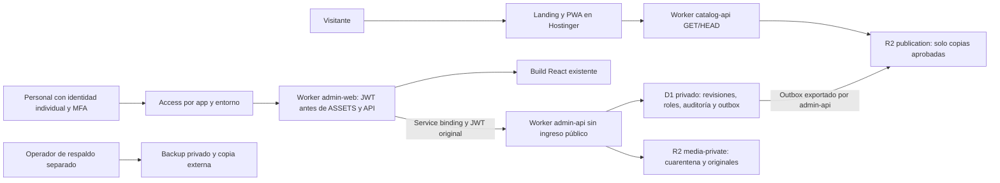

# KUWAGO — Fase 2A: preparación de infraestructura Cloudflare

Fecha: 23 de octubre de 2026, America/Costa_Rica.
Estado: diseño y configuración local no sensible. Sin login, recursos, migraciones,
Access, DNS, Hostinger, commits, push o despliegues remotos.

## 1. Auditoría y compatibilidad con Fase 1C

Repositorio: C:\Users\JV\Desktop\Kuwago Landing\grupo-kuwago-landing-source.
HEAD: 26055d6 — fix: version built assets to prevent stale mobile layouts.
Git conserva modificaciones y archivos sin seguimiento de las fases anteriores:
.gitignore, controlador/datos/HTML del marketplace, package.json y scripts de
build/versionado/servidor; apps/, packages/, adaptadores y documentación nuevos.
No se descartó ni versionó ninguno. Se tomó un inventario SHA-256 de 425 archivos
preexistentes para comprobar que esta fase no los altera.

| Área | Hallazgo | Preparación necesaria |
|---|---|---|
| Contratos | ESM/.d.ts, TS estricto, source api/static_reference, validadores sin Node o React | Compatibles con Web APIs; probar en workerd en 2B, no se ejecutó ahora |
| Publicación | Revisiones de trabajo y publicada separadas; slug/precios/media por revisión | Inmutabilidad, autorización y commit condicionado en D1 |
| Aprobación | validateForPublication comprueba forma/flags, no quién aprobó | Aprobaciones derivadas de D1 y actor autenticado, nunca del JSON de React |
| URLs | Sintaxis válida no prueba que el recurso sea público | Mapper servidor: derivados aprobados y host/prefijo permitidos |
| Proyección | Excluye demo/draft/archived y construye campos explícitos | Seleccionar entidades elegibles; probar que borradores corruptos no bloqueen exportaciones válidas |
| Catálogo v1 | schemaVersion=1, lista limitada a 1000 servicios | Límite de bytes/CPU; paginación futura requiere evolución contractual, sin truncar |
| Admin | React 19.3.1, Vite 8.3.5, TS 5.9.3, Tailwind 4.3.3; contrato local | Hoy solo loopback y demos en memoria; no es control de acceso |
| Marketplace | HTML/CSS/JS, adaptador estático, yoga/chef Stitch; moneda $ desconocida | No activar HTTP ni marcar referencias como verified para llenar la API |
| Carrito | ID/revisión/opción, retiro/cambio; sin reservas o cobros | Cambiar fuente solo tras validar API y vacío/error, sin fallback demo |
| Builds | dist público y apps/admin/dist separados; runtime público permitido explícitamente | Despliegues independientes; assets.directory jamás apunta a la raíz |
| PWA | Manifest/SW y rutas públicas actuales | Permanecen en Hostinger; no extender scope al Admin ni cachear API privada |
| Infra | Sin Wrangler en dependencias inspeccionadas ni configuración activa | Fijar versión y validar esquema en 2B, sin instalar nada ahora |

Variables: se inspeccionaron nombres, no valores de credenciales. No se encontraron
nombres CLOUDFLARE/CF_/WRANGLER/VITE_ en el proceso ni archivos .env/.dev.vars de proyecto
fuera de dependencias/dist. Esto NO demuestra ausencia histórica de secretos ni
autoriza leer almacenes globales. .gitignore ya excluye datos privados y outputs;
no se cambió.

Node 26.1.0/npm 11.13.0 locales. npm audit del 23/10/2026: tres avisos moderados en
la raíz (tailwindcss, postcss-nested, postcss-selector-parser), cero altos/críticos;
cero avisos en Admin y contratos. Son herramientas existentes. Sin audit fix,
cambios de versiones o lockfiles. El informe previo de siete avisos correspondía
a otra fecha; no se reutilizó como resultado actual.

## 2. Arquitectura propuesta y límites de confianza

Decisión de diseño propuesta, no un despliegue existente.

Tres Workers por entorno:
1. catalog-api: api.grupokuwago.com en producción; /v1/catalog y /v1/media/<hash>
   de lectura. Sin binding D1, media-private o admin-api.
2. admin-web: admin.grupokuwago.com; protege React y /api/v1/*. Solo ASSETS y ADMIN_API.
3. admin-api: negocio por Service binding; sin dominio, routes, workers.dev o previews.
   Revalida identidad y permisos por operación.

El Worker público lee un catálogo ya validado y aprobado materializado en R2, sin
consultar la base privada. Un binding R2 no debe presentarse como ACL de solo lectura:
el código público se limita a leer, pero ese bucket solo contendrá material publicable
incluso ante un defecto. Sin KV, Queues, Durable Objects, Images o Workflows iniciales.

Service bindings permiten aislar un Worker de Internet, pero no transportan
implícitamente ctx.access. El backend debe verificar el JWT reenviado.
[Referencia oficial](https://developers.cloudflare.com/workers/runtime-apis/bindings/service-bindings/).

Futuro árbol, NO creado automáticamente:
- apps/admin: React existente.
- apps/admin-web: guardia Access, assets y proxy.
- apps/admin-api: identidad, roles, revisiones, imágenes y materialización.
- apps/catalog-api: catálogo y medios aprobados.
- packages/contracts: existente.
- packages/database/migrations: migraciones futuras, sin SQL ejecutado hoy.
- infra/cloudflare: inventario y configuraciones, hoy solo ejemplos.

## 3. Entornos, nombres y cuentas

Inventario no provisionado: infra/cloudflare/environments.example.json.

| Recurso | development | staging | production |
|---|---|---|---|
| Worker catálogo | kuwago-catalog-development | kuwago-catalog-staging | kuwago-catalog-production |
| Worker web Admin | kuwago-admin-web-development | kuwago-admin-web-staging | kuwago-admin-web-production |
| Worker API Admin | kuwago-admin-api-development | kuwago-admin-api-staging | kuwago-admin-api-production |
| D1 | kuwago-admin-db-development | kuwago-admin-db-staging | kuwago-admin-db-production |
| R2 originales | kuwago-media-private-development | kuwago-media-private-staging | kuwago-media-private-production |
| R2 publicación | kuwago-publication-development | kuwago-publication-staging | kuwago-publication-production |
| R2 backup | kuwago-backups-development | kuwago-backups-staging | kuwago-backups-production |
| Host Admin propuesto | admin-dev.grupokuwago.com | admin-staging.grupokuwago.com | admin.grupokuwago.com |
| Host API propuesto | api-dev.grupokuwago.com | api-staging.grupokuwago.com | api.grupokuwago.com |

Development empieza solo local. Los nombres remotos son reservas propuestas, no
una orden de crear todos los recursos en 2B. Estado local distinto por entorno;
no montar snapshots de producción en pruebas. Staging sin PII ni copias de producción
sin minimización aprobada.

Tres aplicaciones Access Admin, una por entorno. Catálogos development/staging,
si se exponen, tendrán otras dos apps Access con AUD propias; producción será público.
La AUD Admin valida web y backend interno de ESA aplicación; no dos entornos o apps.
IDs de cuenta/base, issuer y audiencias quedan null/vacíos/marcados, no confirmados.

Declarar bindings/vars/secretos explícitamente por entorno, sin confiar en herencia.
Wrangler documenta claves no heredables y account_id configurable por entorno.
[Configuración](https://developers.cloudflare.com/workers/wrangler/configuration/).

Opción mínima: recursos y tokens distintos en una cuenta comprobada. Los nombres no
son límites de seguridad de cuenta. Preferir producción en cuenta separada si los
permisos efectivos no restringen al operador/CI por entorno. Decisión pendiente de
costos: no prometer que un token por nombre aísla D1 si su scope solo es de cuenta.
Para aislamiento fuerte separar cuentas o aceptar explícitamente ese riesgo.
Nunca reutilizar tokens, claves S3, AUD o IDs de base entre ambientes.

## 4. Identidad, frontend y permisos

Access protegerá todo el hostname Admin, sin bypass de /assets, /api, iconos o
rutas móviles. admin-web tendrá assets.run_worker_first=true; de otro modo un asset
puede servirse antes de ejecutar código. La propiedad por sí sola NO valida identidad.
[Comportamiento documentado](https://developers.cloudflare.com/workers/static-assets/binding/).

Validar criptográficamente Cf-Access-Jwt-Assertion por petición: firma RS256, JWKS
del issuer fijo, AUD exacta del entorno, exp/sub/iss/aud obligatorios, nbf si existe
e iat razonable con tolerancia de reloj acotada. No obtener claves de jku/x5u ni del
iss sin verificar del token. Cache/rotación JWKS con refresh acotado; errores o
configuración ausente deniegan. No basta decodificar, confiar en header de email o
comprobar cookie. Una biblioteca auditada como jose se elegirá/testeará en 2B, sin
instalarla hoy. [Recomendación de Cloudflare](https://developers.cloudflare.com/cloudflare-one/access-controls/applications/http-apps/authorization-cookie/validating-json/).

admin-web reenvía el JWT original por el binding; admin-api lo revalida y obtiene
roles de D1 por issuer+sub, no email/roles de React. No propagar identidad inventada
por el navegador. No guardar JWT en localStorage, URL o logs. Tema/idioma siguen siendo
las únicas preferencias persistentes del Admin. Access del personal no define la
futura identidad de huéspedes/clientes: requiere otro diseño.

Roles propuestos, por aprobar:
- viewer: lectura administrativa autorizada.
- editor: borradores e imágenes; no marca verified ni aprueba/publica.
- publisher: aprobación comercial, publicación y archivo; sin gestionar miembros.
- securityAdmin: membresías/permisos; no hereda publicación automáticamente.

Disabled/rol eliminado se comprueban en servidor por petición. En publicación se
revalidan permisos dentro del commit condicionado. Nadie eleva roles desde React.
Cambios de roles privilegiados requieren segundo revisor y no permiten cambiarse el rol a sí mismo. Bootstrap del primer miembro por operador, con dos personas verificadas; no aceptar
al primer visitante como admin. Definir separación editor/revisor y autoaprobación
antes de escrituras. Identidades individuales con MFA en el IdP; aliases de un buzón
compartido no deben representar a varias personas autorizadas.

## 5. CORS, CSRF y rutas alternativas

Admin usa /api/v1/* en su mismo origen, sin CORS administrativo abierto. Mutaciones:
Origin exactamente igual al Admin del entorno, Content-Type application/json,
header X-Kuwago-Request, método permitido, bytes reales acotados y JWT/rol válidos.
Rechazar Origin null/ausente/distinto en ese flujo de navegador. La excepción explícita /api/v1/media permite POST binario JPEG/PNG/WebP con los mismos controles Origin/header/JWT/rol y límites de stream, nunca formularios. Sin escrituras GET,
JSONP o formularios urlencoded. Sec-Fetch-Site/SameSite son defensa adicional: una
subzona comprometida puede ser same-site. Automatización necesitará identidad máquina
explícita, nunca omitir controles por un header.

Si se adopta otro flujo cookie/form, revisar token CSRF ligado a sesión. No existe
aquí ese flujo ni secretos CSRF. Access no es, por sí solo, protección CSRF de negocio.

Catálogo público: GET/HEAD/OPTIONS, allowlist exacta de orígenes públicos aprobados,
Vary: Origin, sin Allow-Credentials o cookies Admin. CORS no autentica ni bloquea bots.
Sin comodines con credenciales. Staging no se consultará desde la landing productiva;
sus pruebas se autenticarán en su origen o mediante desarrollo local aislado.

workers_dev=false y preview_urls=false por ambiente; comprobar estado efectivo en
el dashboard. admin-api sin routes/domains. No compartir previews Vite/Wrangler,
túneles, versiones históricas o un Pages alternativo. Rechazar Host inesperado,
paths codificados/traversal, rutas no declaradas y métodos no permitidos. Sin fetch
de URLs arbitrarias de imágenes.

## 6. D1: esquema propuesto, sin migraciones

Una D1 administrativa por entorno; el catálogo público no necesita otra base.
Migraciones futuras en packages/database/migrations: 0001 entidades/revisiones,
0002 opciones/media, 0003 identidades/aprobaciones, 0004 publicación/outbox/auditoría.
Son grupos propuestos, no archivos SQL. Orden monotónico, checksum/revisión; no editar
migraciones aplicadas o ejecutar DDL al arrancar un Worker. Probar local/staging primero.

Tablas y relaciones:
- services: ID, provenance, status, working_revision_id, published_revision_id,
  row_version, modified_at; restricciones draft/published/archived del contrato.
- service_revisions: ID, service_id, number, slug, category_id, hash canónico,
  sealed_at, created_at; Unique(service_id,number); sellada no mutable.
- service_translations: PK(revision_id,locale), ES/EN, título/descripción.
- categories/category_translations: ID, slug, activo y versión.
- service_options/option_translations/option_prices: identidad estable de opción,
  PK revisión+opción, duración/modalidad y precio discriminado.
- media_assets: clave privada, hash, MIME/bytes/dimensiones, procedencia/aprobación;
  revision_media conserva orden/alt ES/EN por revisión.
- commercial_approvals: revisión+hash, actor/fecha; eventos de aprobación/revocación.
  No actualizar approved con un payload genérico de editor.
- principals/roles/principal_roles: issuer+sub unique, enabled y roles del entorno.
- publication_commands: operación/idempotency key, actor, versión esperada, acción.
- publication_outbox/catalog_state: generación global, estado, intentos y lease.
- audit_events: actor/acción/entidad/revisión/hashes/fecha/request ID, sin JWT ni
  cuerpos completos. Append-only en aplicación, no inmutable ante un admin de la base.

FK compuestas impedirán apuntar a revisión de otro servicio. Crear servicio y primera
revisión atómicamente para resolver referencias circulares. Opción/imagen mantienen
identidad entre revisiones; orden, textos y precio pertenecen a la revisión.
CHECK/NOT NULL para estados/locales, quote sin importe y dinero entero seguro con
moneda explícita. Indexar service_id, estado, revisión publicada, slugs publicados,
outbox y auditoría. Parametrizar SQL; no interpolar filtros/claves de orden.

Mapear D1 al contrato; no guardar el formulario React sin validación. Object key,
MIME/actor son DTOs privados del backend. Aprobaciones se derivan de tablas verificadas.
Referencias Stitch no se importan como dinero verificado.

## 7. Publicación transaccional y materialización

Flujo futuro a demostrar antes de habilitar escrituras:
1. Autenticar/autorizar; validar request, idempotency key y expected row_version.
2. Sellar revisión/hash con traducciones, opciones y medios completos.
3. Leer categorías/aprobación del hash; validateForPublication y PublicCatalogSchema
   sobre mapper servidor. Usar URLs derivadas públicas, nunca URLs privadas del Admin DTO.
4. En UN batch D1: comando con guardas SQL, versión/actor/aprobación verificados,
   cambio de puntero/estado, generación, auditoría y outbox.
5. Guarda obsoleta provoca ERROR SQL real y rollback (constraint/trigger). UPDATE con
   cero filas NO es fallo SQL: no puede dejar auditoría/outbox de publicación exitosa.
   Responder conflicto 409 cuando corresponda.
6. Exportador interno de admin-api genera snapshot público source api desde outbox.
   Escribe derivados aprobados y snapshot en R2 con clave inmutable/hash.
7. Cambiar current.json con ETag condicional y generación monotónica. Si pierde una
   carrera, releer: nunca reintentar generación vieja con un ETag nuevo. Idempotencia
   y reintentos acotados, sin recursión infinita.
8. Solo completar entrega cuando el snapshot sea visible; antes devolver 202/pending
   en un sobre de operación separado de PublicationStatus.

D1 batch es la primitiva prevista; rollback, guardas e idempotencia deben probarse en
runtime local y staging. [D1 API](https://developers.cloudflare.com/d1/worker-api/d1-database/).
R2 evalúa condiciones de escritura con el commit del objeto; eso NO crea transacción
D1+R2. [Consistencia R2](https://developers.cloudflare.com/r2/reference/consistency/).

La materialización entre D1 y R2 es eventual: un archivo puede dejar temporalmente
visible la publicación anterior. Objetivo propuesto 60 s, no garantía durante una falla.
Alertar y mostrar pending/failed; no éxito prematuro ni generaciones que retrocedan.
Snapshot faltante/inválido es error API, no demos ni referencia estática. Ventana de
retiro prioritario requiere aprobación. No se recuperan imágenes ya descargadas.

Al inicio no usar CDN/Cache API para catálogo: ETag, max-age=0,must-revalidate;
errores no almacenables. Privado no-store. Medios con TTL corto aprobado (propuesta
60 s), claves inmutables y pertenencia al manifiesto vigente. No conectar la landing
estática a la API durante la preparación de infraestructura.

## 8. Respaldo, recuperación y pruebas D1

D1 documenta Time Travel de 30 días en Paid y límite de 10 GB por base. Verificar
plan/estado reales. [Time Travel](https://developers.cloudflare.com/d1/reference/time-travel/),
[límites](https://developers.cloudflare.com/d1/platform/limits/).

Propuesta: export diario y antes/después de migraciones críticas, cifrado y copia
privada independiente de Workers; retención 90 días por aprobar. Segunda copia externa
offline protege frente a pérdida de cuenta. Registrar bookmark, generación, checksums
y manifiesto de imágenes. Ensayar restauración en base aislada: conciliar R2/outbox,
conteos/FK/hashes y publicar NUEVA generación con contenido restaurado, sin retroceder
ciegamente el contador de entrega. RPO 24 h/RTO 4 h son objetivos, no SLA comprobados.

Pruebas 2B: migración limpia/incremental, FK/CHECK, rollback, CAS obsoleto, rol revocado,
aprobación de hash anterior, idempotencia repetida, archivo/publicación concurrentes,
falla después de D1 o antes/después de R2 y restauración. No se crearon bases ni se
ejecutaron migraciones locales/remotas en 2A.

## 9. R2: privado, subidas y entrega

Tres buckets por entorno: media-private, publication y backups. Todos sin acceso
público R2 directo, r2.dev ni dominio conectado al bucket. Publication solo contiene
copias aprobadas para catalog-api, no originales. Dejar r2.dev activo crea una ruta
alternativa. [Acceso a buckets](https://developers.cloudflare.com/r2/buckets/public-buckets/).

Upload inicial por proxy Admin con JWT/rol/Origin y streaming: bytes reales hasta
2 MiB, tipo declarado/firma, decodificación completa, 8 MP/4096 px por dimensión como
propuestas, CPU/memoria/tiempo acotados y máximo ocho imágenes por revisión. Rechazar
SVG/HTML/ZIP, archivos corruptos o tamaños falsos. Elegir decoder compatible con
Workers y medir normalización/eliminación de EXIF/GPS: una firma MIME NO basta.
No habilitar Images u otra transformación de pago sin aprobación de presupuesto.

Guardar primero en cuarentena con ID generado por servidor, sin nombre/ruta elegidos
por cliente. Validar, crear derivado limpio y aprobar derechos antes de publicar.
Ningún upload de navegador escribe en publication. Privado se lee por /api/v1/media
con permiso, Content-Type fijo, nosniff y Cache-Control:private,no-store. Conocer un
object key no es autorización.

Si después se adopta upload directo: presign breve, key exacta, token de finalización
y validación posterior en cuarentena. Presign es un bearer token reutilizable hasta
expirar, funciona en dominio S3, no custom domain, y no garantiza aprobación ni límite
real de bytes. No incluirlo en contrato público/logs.
[Presigned URLs](https://developers.cloudflare.com/r2/api/s3/presigned-urls/).
Bindings iniciales no necesitan claves S3. Bucket CORS puede estar cerrado; upload
directo requeriría allowlist propia por entorno.

Worker público solo resolverá keys de derivados presentes en allowlist del manifiesto.
No listará buckets ni aceptará prefijos arbitrarios o URLs externas. Esquema más
comprobación exacta de host/prefijo antes de exportar: approved no vuelve pública
una URL privada por sí mismo.

Limpieza propuesta: cuarentena siete días, huérfanos tras 30 días con doble comprobación
de referencias/operaciones; primero reporte dry-run y aprobación. Conservar revisiones
publicadas y backup. Keys inmutables/hashes sin asumir versionado automático. Backup
sin binding en Workers, operador distinto, considerar bucket locks y copia externa.
Sin lifecycle destructivo configurado hoy.

## 10. Operación, secretos y abuso

Tokens de deploy fuera de React, .env público, wrangler vars y Git. Almacén seguro
CI con secreto distinto por ambiente y aprobación manual de producción. Account ID,
AUD e issuer no son contraseñas, pero deben verificarse, no inventarse. No Global API
Key o rol global al código. Provisión, deploy, migración, backup y negocio son funciones
distintas. Comprobar scopes efectivos D1/R2/Workers/Access/DNS antes de emitir tokens;
no dar DNS write al deploy diario una vez configurados los hosts.

Límites propuestos, no aplicados: JSON 64 KiB, catálogo 1 MiB sin truncado silencioso,
upload 2 MiB/30 s; lectura 120/min/clave, escritura 30/min/actor, uploads 5/min/actor.
CPU orientativa 50 ms catálogo/web y 100 ms API; medir JWT/decoder antes de fijarlos.
No son topes globales de facturación ni garantías de rendimiento. El Rate Limiting
de Workers es aproximado y local al centro de datos, no una cuota mundial estricta.
[Limitaciones](https://developers.cloudflare.com/workers/runtime-apis/bindings/rate-limit/).

Rate-limit temprano, consultas acotadas/indexadas, contar stream además de revisar
Content-Length; sin SQL dinámico, fetch arbitrario o retries infinitos. Una cuota
estricta necesita decisión de coordinación y costo; no crear Durable Objects antes.
Verificar WAF/alertas en cuenta: Workers Paid no incluye por inferencia todo el catálogo
de productos de seguridad.

Auditoría crítica D1 sin muestreo; logs técnicos sanitizados/muestreados aparte. No
JWT/cookies/presigns/headers completos/cuerpos privados. Alertas por 5xx, JWT anómalos,
outbox pendiente, fallos de backup, límites, crecimiento R2 y consumo por entorno.
Observabilidad de retención corta no sustituye auditoría del negocio.

## 11. Costos públicos; cuenta todavía no comprobada

Documentación consultada el 23/10/2026, USD sin impuestos/concesiones/contrato específico.
Workers Paid fue informado por el usuario; no se entró a dashboard para comprobar
ciclo, uso restante o cargos existentes. Cuotas por cuenta, no por cada entorno.

| Producto | Referencia pública | Exceso |
|---|---|---|
| Workers Paid | Mínimo $5/mes/cuenta; 10 M requests y 30 M CPU-ms/mes | $0.30/M requests y $0.02/M CPU-ms |
| Workers Logs hasta 30/11/2026 | 20 M eventos/mes; retención siete días | $0.60/M eventos; nuevo modelo desde 01/12/2026 |

[Workers y aviso de cambio de logs](https://developers.cloudflare.com/workers/platform/pricing/).
Assets protegidos con run_worker_first ejecutan código: no contar toda la autenticación
como estáticos gratuitos. Medir requests facturables/CPU, no multiplicar ciegamente
por número de Workers.

| D1 Paid | Incluido | Exceso |
|---|---|---|
| Filas leídas | 25 mil millones/mes | $0.001/M |
| Filas escritas | 50 M/mes | $1/M |
| Almacenamiento | 5 GB totales | $0.75/GB-mes |

Cuenta filas examinadas y efectos de índices, no solo resultados.
[Precios D1](https://developers.cloudflare.com/d1/platform/pricing/).

| R2 Standard | Incluido | Exceso |
|---|---|---|
| Storage | 10 GB-mes/mes | $0.015/GB-mes |
| Operaciones A | 1 M/mes | $4.50/M |
| Operaciones B | 10 M/mes | $0.36/M |

Egress R2 sin cargo; requests/operaciones/Worker siguen costando. Hay redondeo de
unidades facturables. Infrequent Access añade recuperación/retención mínima, por eso
no se propone inicialmente. Backup/cuarentena/derivados cuentan para storage/operaciones.
[Precios R2](https://developers.cloudflare.com/r2/pricing/).

Access/Zero Trust es otro plan: la página pública muestra Free hasta 50 usuarios y
pago desde $7/usuario/mes, sujeto a condiciones de contratación por confirmar. No
activar suscripción por inferencia de Workers Paid.
[Planes](https://www.cloudflare.com/plans/), [Access](https://www.cloudflare.com/sase/products/access/).
DNS parcial también depende del plan de zona, separado de Workers y Hostinger Business.

Presupuesto B pendiente; proponer alertas 50/80/100% y umbrales por recurso ANTES de
abrir tráfico. Son notificaciones, no un freno contractual de gasto. Documentadas
para Pay-as-you-go: comprobar disponibilidad, destinatarios y base fija/impuestos.
[Budget alerts](https://developers.cloudflare.com/billing/manage/budget-alerts/).
Sin total garantizado: faltan tráfico, CPU, almacenamiento, operaciones, miembros,
retención y decisión de cuentas; separarlas puede añadir otro mínimo Workers Paid.
Images, Queues, Workflows, Logpush y WAF ampliado son decisiones adicionales, no
recursos habilitados por esta fase.

## 12. DNS, HTTPS, correo y Hostinger

Consulta DNS pública de solo lectura del 23/10/2026 desde este equipo:
- NS: aurora.dns-parking.com y nebula.dns-parking.com.
- MX: mx1.hostinger.com prioridad 5; mx2.hostinger.com prioridad 10.
- SPF: v=spf1 include:_spf.mail.hostinger.com ~all.
- DMARC: v=DMARC1; p=none.
- A/AAAA observados; no son valores que deban fijarse sin exportar la zona.
- Selectores DKIM, inventario completo, DNSSEC/DS y CAA sin comprobar. La herramienta
  local no admitió tipo CAA: NO implica que no exista ese registro.
No se accedió a cuentas o cambió DNS. Esto no sustituye el export autoritativo del hPanel.

Workers Custom Domains requiere zona activa Cloudflare y Worker; gestionará registros
y HTTPS del hostname. No hay receta genérica CNAME en Hostinger hacia workers.dev.
[Requisitos](https://developers.cloudflare.com/workers/configuration/routing/custom-domains/).

Camino recomendado a evaluar: delegar DNS autoritativo a una zona Cloudflare, conservando
registro del dominio, hosting y correo en Hostinger. Reproducir y verificar la zona:
apex/www a Hostinger DNS-only al inicio, MX/SPF/DKIM/DMARC/TXT/CAA/SRV, verificaciones y
nombres de correo sin proxy. Coordinar DS antiguo, NS y nuevo DS para no romper DNSSEC;
no activarlo/retirarlo automáticamente, usar plan según el estado real.

Solo después añadir custom domains Admin/catálogo y verificar HTTPS. Ninguna ruta
Worker capturará grupokuwago.com/* o www.grupokuwago.com/*. No trasladar apex a Workers,
no cambiar HTML público/SW/enlaces del catálogo. No HSTS includeSubDomains/preload
antes de verificar todos los hosts.

Si se exige mantener nameservers Hostinger: evaluar DNS parcial CNAME, documentado
solo para Cloudflare Business/Enterprise. Hostinger Business y Workers Paid NO son
Cloudflare Business. Confirmar rutas/certificados/Access antes de contratar. No asumir
delegación aislada de subdominio o workers.dev como sustituto soportado en ese plan.
[Disponibilidad de DNS parcial](https://developers.cloudflare.com/dns/zone-setups/partial-setup/).

Rollback: export con TTL anteriores, resolución externa y ventana acordada; restaurar
NS/DS coherentes si falla, sabiendo que cachés no revierten inmediatamente. Probar
web/PWA, HTTPS y correo entrante/saliente con SPF/DKIM/DMARC antes/después. No endurecer
DMARC o alterar SPF durante esta migración; revisar la política de correo por separado.

## 13. Archivos y límite de validación

Solo nuevos archivos en infra/cloudflare y dos documentos de arquitectura/runbook.
Sin main/assets/IDs válidos, rutas vacías y mutaciones deshabilitadas por intención.
No hay código de Worker, SQL, migraciones, Terraform, secretos o login. Las vars no
ejecutan guardias: requieren implementación y pruebas antes de tener significado.

Comprobación 2A: JSON, nombres únicos, bindings por Worker, servicio del mismo entorno,
sin rutas/cron/remote:true, previews desactivados, run_worker_first, Access vacío y
sin IDs plausibles. No se instaló/invocó Wrangler, ni siquiera dry-run; validar contra
su versión/esquema real sigue pendiente en 2B.

Verificaciones existentes sin regenerar la landing: TS noEmit, lint y pruebas de
contratos/Admin/catálogo/PWA/loader/versionado, check estático y aislamiento de outputs
existentes. Se inspeccionan los builds 1C; NO se ejecuta build público porque escribe
assets generados/dist. El hash final debe demostrar cero cambios sobre 425 archivos
iniciales; el acta de cierre registra el resultado real.

## 14. Riesgos y controles pendientes

| Riesgo | Control/decisión |
|---|---|
| Admin expuesto antes de seguridad real | No desplegar plantilla/assets; JWT antes de ASSETS y Access verificado |
| Auth en React o confianza en email | JWT criptográfico, roles servidor y MFA individual |
| CI con scope demasiado amplio | Revisar permisos y separar cuenta de producción si hace falta |
| Bypass por previews/URLs/R2 público | Desactivar y probar todas las vías sin sesión |
| Token de otro entorno | AUD única por app/ambiente y pruebas negativas cruzadas |
| Precio/referencia tratado como real | Aprobación comercial sin reetiquetado automático |
| URL privada sintácticamente válida | Mapper de derivados, host/prefijo exactos; no copiar DTO privado |
| Carrera/falsa publicación | Guardas SQL, outbox idempotente, generación monotónica, pending separado |
| Retiro diferido entre D1/R2 | Ventana aceptada, monitoreo y procedimiento urgente sin garantía falsa |
| Consumo excesivo | Límites medidos, alertas, rate limiting aproximado y bloqueo operativo |
| Restauración desincronizada | Manifiestos/checksums y restore aislado D1/R2/outbox |
| Corte de correo/DNSSEC | Export completo, DKIM/CAA/DS comprobados, pruebas y rollback con TTL |
| Plan/cuota no comprobados | Revisar facturación, Access y plan de zona antes de crear recursos |

## 15. Checklist de recursos para 2B

- [ ] Cuenta(s), propietario, Workers Paid, facturación y presupuesto comprobados.
- [ ] Decisión de cuenta productiva separada y scopes efectivos por token/entorno.
- [ ] Tres ambientes; desarrollo inicialmente solo local.
- [ ] Una D1 por entorno remoto aprobado, sin reutilizar ID o datos.
- [ ] Tres R2 privados por entorno aprobado, sin endpoints directos públicos.
- [ ] Tres futuros Workers por entorno, admin-api sin ingreso público.
- [ ] Access Admin por ambiente; catálogo no productivo protegido si se expone.
- [ ] IdP/MFA, usuarios individuales, roles y bootstrap revisados.
- [ ] Export DNS, DKIM/CAA/DNSSEC/DS y ruta de delegación aprobados.
- [ ] Límites, retención, RPO/RTO y operador de respaldo acordados.
- [ ] Revisión inmutable, guardas, auditoría, outbox y retiro eventual aceptados.
- [ ] Versiones Wrangler/jose/decoder revisadas, sin adoptar beta por defecto.
- [ ] Pruebas de seguridad, aislamiento, rollback y restauración definidas.
- [ ] Autorización específica para cada bloque remoto y entorno con costos posibles.

Procedimiento: docs/PHASE-2B-RUNBOOK.md. La Fase 2A se detiene antes de autenticación
remota, provisión, migración, Access, DNS o deploy.

## 16. Acta de cierre local

Resultados de esta sesión:
- 217 invariantes de plantillas/inventario correctas; 26 nombres propuestos únicos.
- Comprobación adicional: upload binario conserva Origin/header/JWT/rol; no cambio de
  rol propio. Es diseño, no comportamiento de una API implementada.
- 67 pruebas existentes correctas: 49 Node (12 contratos, 6 catálogo, 24 PWA,
  4 loader, 3 assets) y 18 Admin Vitest; cero fallos.
- TypeScript noEmit de contratos y Admin, lint de contratos/Admin/catálogo correctos.
- Check estático e inspección de aislamiento de los artefactos 1C correctos.
- SHA-256: 425 archivos preexistentes intactos; nueve nuevos archivos, solo configs
  y documentación. Ningún cambio fuera de ese alcance.
- Sin builds nuevos, instalaciones, Wrangler, bases locales/remotas, buckets,
  cuentas, Access, DNS, Hostinger, commit, push o deploy en esta fase.

Archivo de entrega: este informe; docs/PHASE-2B-RUNBOOK.md; y siete archivos en
infra/cloudflare (README, inventario, política, tres Wrangler example y dev-vars vacío).
Los precios son públicos; las capacidades y facturación de la cuenta siguen pendientes.
