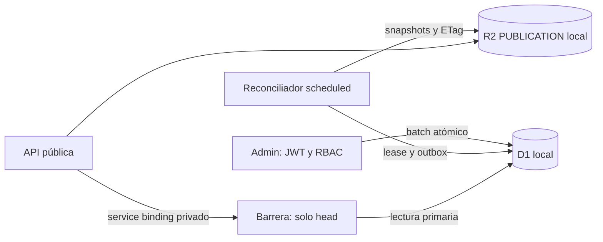

# Fase 2B.4R — Registro de diseño previo a implementación

Inicio: 23/10/2026. Cierre local: 24/10/2026, America/Costa_Rica.

Alcance: DEV local, sin recursos o escrituras remotas. Se aplica la guía senior-backend.

Riesgos identificados antes de editar código:
- El outbox es transaccional en D1, pero la entrega y su acknowledgement son posteriores.
- Un 202 no asegura visibilidad ni retirada; la copia anterior puede sobrevivir indefinidamente.
- El retry manual no persiste backoff, leases, escalamiento ni errores completos.
- Comparar solo generación permite confundir una restauración D1 con el historial R2 anterior.
- El Worker público no puede comprobar vigencia; tampoco debe recibir acceso al Admin ni a multimedia privada.
- Legacy sin catalog_json no se puede regenerar como oferta aprobada sin revisión.

Decisión: outbox persistente + handler scheduled compatible con Cron Triggers,
reintentos acotados con lease/fencing y snapshots identificados por epoch/generación/hash.
No Queue: no aporta atomicidad D1–R2 y duplicaría transporte para este único snapshot completo.
Una barrera Worker separada, privada por service binding, expone solo el encabezado
vigente de publicación. Público conserva cero D1 y cero binding al Admin. Si no puede
verificar coherencia, responde 503 sin servir la copia anterior.

Restauración: respaldo lógico consistente, destino local vacío/aislado, nueva epoch,
publicación pausada y servicios restaurados retirados por defecto. Historial/aprobaciones
y auditoría se conservan; reanudar vacío no república revisiones antiguas.

## Implementación y separación de capacidades



La nueva 0005 añade publication_control, epoch, metadata de retry/lease en el
outbox existente, publication_alerts y publication_recovery_events. No cambia
0001–0004 ni duplica servicios/revisiones. Las bases con historial previo empiezan
pausadas, con eventos legacy en cuarentena; no se inventa un snapshot aprobado.

Admin conserva su middleware y auditoría de negocio transaccional. Cada cambio
público actualiza en el mismo batch el outbox y el head requerido: epoch,
generación y SHA-256 del envelope público. La versión global sigue protegiendo
la proyección frente a escrituras concurrentes. El modo paused impide mutaciones.

El público mantiene cero binding D1, cero PRIVATE_MEDIA y cero binding al Admin.
Su único binding adicional es CATALOG_BARRIER hacia otro Worker, sin ingress.
Este Worker solo devuelve epoch/mode/generation/payloadHash; no devuelve SQL,
usuarios, roles, borradores o contenido privado. Su D1 binding NO es una ACL nativa
de solo lectura: se limita por código y ausencia de ingress, por lo que proteger
el despliegue de ese código sigue siendo parte de la seguridad.

Antes y después de leer el snapshot, el público consulta la barrera. Las lecturas
usan una sesión first-primary cuando está disponible; sin sesiones, el binding
D1 ordinario se lee en su primario. Compara exactamente epoch, generación y hash.
Cualquier incoherencia o dependencia caída devuelve 503, sin caché ni fallback.
El R2 actual ya no es autoridad para decidir qué generación debe publicarse.

## Reintentos, confirmación y errores

- Cron propuesto: cada minuto en el Worker reconciliador. Su handler fetch devuelve
  404; la ejecución programada es una capacidad del runtime, no un endpoint Admin
  sin JWT. No se añadió una Queue ni un webhook externo.
- El outbox conserva cada comando y su snapshot completo. El consumidor toma la
  generación vigente de la epoch actual, sin depender de memoria del proceso.
- Lease persistido de 30 s y token de fencing. La adquisición es un UPDATE
  condicional; el acknowledgement vuelve a comprobar token, epoch, hash y head.
- Hasta ocho intentos; backoff 15, 30, 60, 120, 240, 480, 900 s, con tope 900 s.
  Son plazos mínimos; el Cron puede ejecutar después. Las llamadas R2 tienen una
  espera acotada de 5 s. Un timeout no garantiza cancelar una operación ya enviada.
- Snapshots históricos en catalog/v2/{epoch}/{generation}-{hash}.json, creados
  condicionalmente y comprobados por hash. catalog/v1/current.json es la copia
  servida, validada contra D1. Un archivo histórico corrupto escala en vez de
  sobrescribirse silenciosamente.
- Si un proceso muere, el lease vence y otro retoma. Si murió en el octavo intento,
  se escala al vencer, evitando un pending imposible de reclamar.
- delivery_state distingue pending, delivered, superseded, escalated y quarantined.
  Los comandos superados no se borran: quedan explícitamente superseded en outbox.
  El campo histórico publication_commands.state='visible' indica reconocimiento
  o superación, no que un usuario haya visto cada snapshot intermedio.
- Errores persistidos por código acotado, sin tokens ni excepciones crudas. Si D1
  falla al registrar el error, no se confirma éxito; el evento y lease existentes
  permanecen recuperables. Un payload corrupto escala, nunca se elimina.

GET /api/v1/catalog/status requiere audit:read y muestra pendientes, antigüedad,
errores, próximos intentos, leases y cuarentena. POST /catalog/sync respeta backoff.
Solo Admin/Super pueden enviar {retryEscalated:true}; se registra
catalog.retry_authorized transaccionalmente y se rearma únicamente el head actual.
No existe replay HTTP de respuestas de POST de negocio: ante pérdida de respuesta,
el cliente debe releer estado y versiones, no reenviar ciegamente.

## Retirada y política operativa

| Situación | Respuesta/estado | Comportamiento público |
|---|---|---|
| Commit D1 y R2/ack confirmados para esa generación | 200, confirmed | Catálogo vigente; servicio retirado ausente. |
| D1 confirmado, materialización pendiente | 202, pending; withdrawal=materialization_pending | Copia anterior rechazada por la barrera; 503 hasta converger. |
| Otra operación autorizada supera la generación | 202, superseded | Decide el head más reciente, sin certificar la retirada anterior. |
| D1/barrera/R2 no disponibles o hash distinto | Fallo cerrado | 503, nunca copia antigua como fallback. |
| Reintentos agotados/cuarentena | escalated/quarantined | Sigue cerrado hasta intervención explícita. |

Objetivo propuesto de convergencia: **120 segundos** con dependencias sanas y Cron
ejecutándose. No es SLA contractual ni latencia medida en Cloudflare. Durante una
caída prolongada se sacrifica disponibilidad del catálogo completo, no seguridad.

Propiedad comprobada: una solicitud cuya comprobación final del head ocurre
después del commit de retirada no devuelve el snapshot anterior. La prueba también
retira entre las dos lecturas. No se puede retirar una respuesta ya autorizada/en
vuelo ni borrar contenido que un navegador ya recibió. No hay transacción D1–R2.
La landing Hostinger todavía no consume esta API y no se modificó su apariencia.

Alertas locales durables (publication_alerts) y logs estructurados:
- delivery_error al fallar entrega/integridad;
- withdrawal_overdue si una retirada/archivo pendiente supera 120 s;
- retry_exhausted al agotar intentos;
- recovery_required si el entorno pausado contiene cuarentena.
Persisten primera/última observación y ocurrencias, sin eliminar el evento original.
No se enviaron notificaciones externas. Antes de remoto habrá que conectar estas
señales a un canal operativo con responsable, retención y pruebas de entrega.

## Recuperación coordinada y respaldo lógico

1. Detener writers/scheduler locales antes del procedimiento operativo. Conservar
   la base y bucket fuente: nunca se restaura encima ni se borran archivos previos.
2. recovery:backup lee todas las tablas de aplicación en UN batch D1 consistente.
   Incluye revisiones, aprobaciones, identidades, roles, comandos y auditoría.
   El ledger d1_migrations se excluye: lo administra Wrangler, no el backup.
3. El envelope incluye schemaHash, SHA-256 del contenido y snapshot R2 solo si
   coincide con el head capturado. Si falta R2, se registra null; el backup D1 sigue
   siendo restaurable únicamente en cuarentena, no se declara respaldo R2 completo.
4. recovery:restore genera una carpeta local nueva con UUID, ejecuta la cadena SQL
   mediante Wrangler --local y crea su ledger genuino. Verifica schema, tablas,
   columnas y digest; nunca ejecuta SQL proporcionado por el archivo de backup.
   La huella de schema ignora solo espacios fuera de literales/identificadores
   citados para aceptar CREATE equivalente después de ALTER frente a rebuild.
5. El destino debe estar vacío y tener otra epoch. Una guarda dentro del batch
   vuelve a comprobarlo. Se restauran filas y triggers transaccionalmente;
   restricciones diferidas inválidas revierten schema, filas y roles completos.
6. En ese mismo batch: nueva epoch, paused, head vacío, servicios anteriormente
   publicados a draft, aprobaciones activas revocadas y outbox quarantined. Se
   conserva contenido sellado/historial y se añade un evento de recuperación.
   Una copia antigua de R2, incluso válida/de generación mayor, queda rechazada.
7. verify comprueba foreign keys, conteo de publicados y coherencia entre head,
   snapshot histórico y copia actual. Paused con materializationMatches=false es
   el estado esperado inmediatamente después de restaurar, no una promoción lista.
8. Tras revisar el inventario, resume-empty y reconcile-restored habilitan SOLO un
   catálogo vacío en ese destino. No cambian el origen ni conectan el destino al
   server existente. Para reponer un servicio: nueva revisión, nueva aprobación
   independiente y publicación normal, no restaurar punteros viejos.

Legacy: aplicar 0005 pausa automáticamente un historial previo. El comando
quarantine-legacy exige --confirm-withdraw-all; conserva filas, revoca aprobaciones,
retira publicados y rota epoch. Solo después se puede reanudar vacío. No regenerar
catalog_json=NULL a partir de datos no revalidados.

Los backups quedan en .wrangler/recovery, ignorados por Git y por el build público.
Contienen datos privados: restringir ACL, no compartirlos como assets ni subirlos
sin cifrado/política aprobada. SHA-256 comprueba integridad, NO autenticidad frente
a un operador que pueda sustituir el archivo y recalcularlo. Límite actual de
restore: 20 MB; no es una solución de backup para volúmenes arbitrarios.

RPO: el punto del backup. Operaciones posteriores no se inventan ni se declaran
recuperadas: la fuente se retiene para conciliar esa cola/auditoría antes de una
promoción. No se restaura ni trunca la auditoría del origen. R2 original/imágenes,
copias externas cifradas, retención y recuperación regional siguen fuera de alcance.

## Comandos locales

Desde la raíz del repositorio:
```powershell
npm --prefix infra/cloudflare/dev run build
npm --prefix infra/cloudflare/dev run migrate:local
npm --prefix infra/cloudflare/dev test
npm --prefix infra/cloudflare/dev run lint
npm --prefix infra/cloudflare/dev run validate:config
npm --prefix infra/cloudflare/dev run validate:public
npm --prefix infra/cloudflare/dev run validate:barrier
npm --prefix infra/cloudflare/dev run validate:reconciler
```

Simulación periódica (dos terminales, solo loopback):
```powershell
npm --prefix infra/cloudflare/dev run dev:reconciler
npm --prefix infra/cloudflare/dev run reconcile:watch
```
El watcher dispara un scheduled local al iniciar y cada 60 s, sin solaparse. Sin
él, el handler puede probarse manualmente; Wrangler dev no sustituye un Cron remoto.
Se probó el watcher con --once y el handler real dentro de workerd.
dev:stack prepara los cuatro Workers juntos para inspección local; no despliega.

Recuperación (detener servidores locales primero):
```powershell
npm --prefix infra/cloudflare/dev run recovery:backup
npm --prefix infra/cloudflare/dev run recovery:restore
npm --prefix infra/cloudflare/dev run recovery:verify
# Solo tras revisar el destino pausado:
node infra/cloudflare/dev/scripts/recovery.mjs resume-empty --confirm-empty
node infra/cloudflare/dev/scripts/recovery.mjs reconcile-restored --confirm-empty
npm --prefix infra/cloudflare/dev run recovery:verify
```
Los últimos comandos usan exclusivamente el destino UUID del último restore
exitoso. No admiten endpoints remotos ni destinos arbitrarios.

## Validación y evidencias

Resultado final comprobado: **93 backend + 49 contratos/público + 18 Admin
= 160 comprobaciones**, sin omitidas. El contador Node conserva contenedores, igual
que la fase anterior; no se midió cobertura porcentual.

Se probaron R2 caída; backoff; ocho fallos/escalamiento; retry autorizado con RBAC;
dos sincronizadores; llamadas duplicadas; eventos superados; publicación seguida
de retirada; snapshots antiguos/divergentes; retirada entre lecturas de barrera;
sincronizador viejo retrasado; interrupción entre archivo y copia actual; payload
D1 corrupto; restore parcial; legacy; backup manipulado; FK inválida y rollback de
restore; reinicio REAL workerd con persistencia y checkpoint de lease; recuperación
al vencer lease y agotamiento en el último intento sin quedar atascado.

Scheduled real workerd convergió sin POST /catalog/sync. El CLI completo se ejecutó:
backup → nuevo destino con cinco migraciones → paused → verify → resume vacío →
reconcile-restored → verify: cero referencias inválidas, cero publicados y
materializationMatches=true. Fuente preservada. Las pruebas con historial
conservaron dos revisiones y auditoría y revocaron aprobaciones restauradas.

Logs locales ignorados: .wrangler/resilience-tests.log,
.wrangler/resilience-faults.log y .wrangler/recovery-cli-verification.log.
Los fallos prolongados usan reloj simulado; no se midieron 120 s reales de red.
TypeScript, lint, builds backend/Admin, regresiones públicas y aislamiento:
correctos. Cuatro dry-runs Wrangler correctos, sin subir bundles.
SQLite del destino restaurado abierto readOnly: integrity_check=ok,
foreign_key_check vacío y cinco migraciones registradas.
Escaneo acotado de 181 archivos de fuentes/configuración no ignorados: sin patrones
de claves privadas, JWT literales o asignaciones reconocibles de secretos. No
incluye historial completo, archivos ignorados o credenciales de la cuenta.
npm audit backend: cero avisos; sin dependencias nuevas.
La cadena de avisos moderados de compilación pública ya documentada no se cambió.

430 fuentes previas fuera de infra/database (incluyendo Admin, landing y contratos)
mantienen sus hashes. SQL 0001–0004 intactos y checksums verificados. No hubo cambios
visuales, commits, push, deploy, Access, DNS, Hostinger o conexiones D1/R2 remotas.

## Archivos de esta fase

Nuevos:
```text
docs/PHASE-2B4R-RESILIENCE.md
packages/database/migrations/0005_publication_resilience.sql
infra/cloudflare/dev/src/barrier.ts
infra/cloudflare/dev/src/reconciler.ts
infra/cloudflare/dev/src/catalog/head.ts
infra/cloudflare/dev/src/catalog/recovery.ts
infra/cloudflare/dev/scripts/recovery.mjs
infra/cloudflare/dev/scripts/reconcile-watch.mjs
infra/cloudflare/dev/test/resilience.test.mjs
infra/cloudflare/dev/wrangler.barrier.local.json
infra/cloudflare/dev/wrangler.reconciler.local.json
```
Modificados:
```text
packages/database/migrations.sha256.json
packages/database/README.md
infra/cloudflare/dev/README.md
infra/cloudflare/dev/package.json
infra/cloudflare/dev/scripts/build.mjs
infra/cloudflare/dev/scripts/local.mjs
infra/cloudflare/dev/src/catalog/delivery.ts
infra/cloudflare/dev/src/catalog/publication.ts
infra/cloudflare/dev/src/catalog/routes.ts
infra/cloudflare/dev/src/catalog/snapshot.ts
infra/cloudflare/dev/src/catalog/transaction.ts
infra/cloudflare/dev/src/catalog/types.ts
infra/cloudflare/dev/src/public.ts
infra/cloudflare/dev/test/auth-fixtures.mjs
infra/cloudflare/dev/test/catalog-api.test.mjs
infra/cloudflare/dev/test/config-storage.test.mjs
infra/cloudflare/dev/wrangler.public.local.json
```

## Criterios antes de autorizar DEV remoto y siguiente etapa

Los bloqueantes de reconciliación y restore quedan abordados/probados LOCALMENTE;
no se certifica que una infraestructura todavía no desplegada tenga estas garantías.

1. Revisar/aprobar 0005, barrera y política 503/SLO, y el procedimiento de cuarentena.
2. Autorizar aparte recursos, bindings, SQL y despliegues DEV concretos. Público
   solo puede alcanzar la barrera; cero ingress externo para barrera/reconciliador,
   sin workers.dev/previews alternativos ni lectura pública directa de R2.
3. Comprobar Cron real, sesiones primarias, service binding, alertas entregadas a
   operador, cuotas/costos y pruebas de caída/restore en DEV remoto aislado.
4. Acordar RPO/RTO, respaldo externo protegido, retención de snapshots/alertas y
   recuperación de imágenes. No restaurar solo D1 ni promover una copia vieja.
5. Medir costo/latencia de dos lecturas primarias por solicitud, backlog/contención,
   carga y crecimiento del snapshot/backup. El catálogo actual limita 1000 servicios
   y 1 MiB; el estado/backup aún requiere evaluación a volumen real.
6. Integrar después React con estados pending/superseded/escalated, 409, readiness
   y retiros; añadir pipeline R2 local con bytes verificados. Sin cambio visual aquí.

Fuentes oficiales consultadas para capacidades, no como prueba de despliegue:
[Cron](https://developers.cloudflare.com/workers/configuration/cron-triggers/),
[service bindings](https://developers.cloudflare.com/workers/runtime-apis/bindings/service-bindings/),
[D1 sessions/batch](https://developers.cloudflare.com/d1/worker-api/d1-database/),
[R2 conditional operations](https://developers.cloudflare.com/r2/api/workers/workers-api-reference/).
