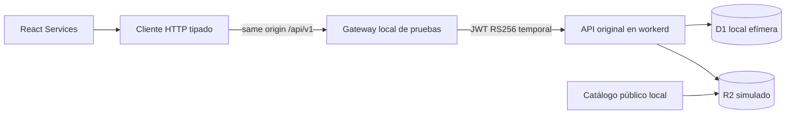

# Fase 2B.5 — Integración local Admin React y API

Fecha: 24/10/2026, America/Costa_Rica. Alcance exclusivamente local.
La fuente predeterminada de Services es la API; nunca se cargan demos como fallback.
No se modificaron la landing, el marketplace público, contratos, SQL 0001–0005,
Access, DNS, Hostinger ni recursos remotos. Trabajo Git anterior conservado.

## Auditoría y arquitectura

El módulo 1B conservaba todo en memoria y cambiaba etiquetas de publicación sin
escrituras. Su modelo presentacional solo tenía una opción y categorías fijas.
La API usa revisiones, categorías con IDs estables, múltiples opciones, ETags,
aprobación independiente y entrega separada del estado D1. No era seguro traducir
simplemente los botones demo en peticiones sin conservar esos datos.

Se añadieron vistas conectadas con las mismas piezas UI, tokens, tipografía,
shell y CSS del módulo aprobado. La demostración anterior queda seleccionable
explícitamente en tests/desarrollo; no se ofrece como respaldo del modo API y se
elimina del flujo de producción por condiciones de compilación.



El gateway es infraestructura TEST en test/admin-harness.mjs, no un backend nuevo
de negocio. Ejecuta el bundle administrativo original dentro de workerd mediante
Miniflare; no sustituye la verificación de identidad ni RBAC. El catálogo de la
prueba HTTP invoca el mismo bundle público con sus bindings locales y barrera.
El aislamiento entre Workers reales continúa cubierto por la suite backend 2B.4R.

## Cliente y endpoints conectados

admin-client.ts reutiliza AdminServiceSchema, CategorySchema,
ServiceRevisionSchema y ServicePriceSchema; valida además envelopes, versiones,
ETags y respuestas de sesión/sincronización. No duplica reglas SQL de publicación.
El servidor sigue siendo la autoridad, aunque se manipulen botones o permisos React.

| Función | Endpoints / comportamiento |
|---|---|
| Identidad y permisos | GET /api/v1/session; principal/rol/permisos del servidor. |
| Listado | GET /services con cursor/limit; carga incremental y filtros de nombre ES/EN, categoría y estado sobre registros cargados. No N+1 de detalles. |
| Detalle y borrador | GET /services/:id, POST /services, PATCH /services/:id. Preserva todas las opciones, referencias de imágenes y notas internas. |
| Categorías | GET /categories, POST /categories, PATCH /categories/:id con versión. IDs, active y traducciones ES/EN. |
| Historial | GET /services/:id/revisions y /revisions/:revisionId; paginación, revisión histórica solo lectura. |
| Validación | POST /services/:id/validate. No equivale a aprobación. |
| Aprobación y estados | POST /approve, /publish, /unpublish, /archive con If-Match y confirmación. Aprobación independiente exigida por backend. |
| Entrega | GET /catalog/status, POST /catalog/sync; reintento escalado confirmado con retryEscalated y permisos del servidor. |

Los PATCH de contenido envían un snapshot completo, nunca modifican una revisión
sellada. El historial/preview permite comparar sin sobrescribir el formulario.
La edición ES/EN viaja en ese snapshot, sin necesidad de duplicar el endpoint
especializado /translations. Las opciones existentes se editan/preservan; crear o
eliminar opciones desde la UI queda fuera de esta integración del formulario 1B.

HTTP: credentials same-origin, no-store, JSON, X-Kuwago-Request, If-Match exacto.
No Authorization ni JWT emitido/almacenado por React. Solo GET transitorios se
reintentan una vez; POST/PATCH jamás automáticamente. AbortSignal cancela lecturas
y peticiones en desmontaje; timeout de 10 s por intento. Una respuesta ambigua de
escritura exige consultar el servidor antes de repetir: no hay replay idempotente
de POST de negocio en la API actual.

Se distinguen 401, 403, 409, 422, red/timeout, cancelación y respuesta inválida.
409 conserva el formulario; la recarga que descarta cambios pide confirmación.
Hay advertencias al navegar, volver por historial o cerrar con cambios pendientes.
La sesión expirada bloquea operaciones sin convertir el estado temporal en guardado.
Cerrar explícitamente la sesión local o cambiar identidad limpia el estado privado
de las vistas; reautenticar la misma identidad puede conservar edición temporal.

## Identidad de pruebas y límites de confianza

No existe login simulado que devuelva roles desde React. El operador debe iniciar
el harness con DOS flags explícitos; sin ellos termina antes de aprovisionar datos:
```powershell
npm --prefix infra/cloudflare/dev run dev:admin-test -- --provision-test-identities --allow-test-reviewer
```

Ese proceso crea una D1 efímera con migraciones 0001–0005 y cuatro identidades
sintéticas: editor, editor2, reviewer (admin de prueba) y disabled. No crea
super_admin. Los grants son fixture explícita, no efecto de iniciar sesión.
No toca la D1 persistente de desarrollo ni utiliza credenciales de Cloudflare.

Genera un par RS256 solo en memoria. El verificador original jose comprueba firma,
algoritmo, issuer/audience, sub, tiempos y JWKS; en este entorno la respuesta JWKS
se suministra por el transporte de test para la URL fija del emisor de pruebas.
El issuer no se presenta como un equipo Cloudflare realmente configurado.

El operador recibe credenciales aleatorias de un solo uso, válidas diez minutos;
seleccionar una identidad sin su credencial no autentica. Se validan hashes con
comparación constante y se consume la credencial. Antes de emitir una sesión,
se consulta /session con el JWT real y se comprueba D1: disabled es rechazado.

El navegador solo recibe una cookie opaca HttpOnly, SameSite=Strict, con TTL de
diez minutos. Los JWT temporales se firman en el servidor de test, no pasan al
frontend. En HTTP loopback la cookie no usa Secure; esto NO es una configuración
válida para remoto. El harness solo escucha 127.0.0.1:8794 y valida Host/origen.
Vite sirve 127.0.0.1:5175 (5185 E2E). La escritura del navegador exige origen exacto,
JSON y X-Kuwago-Request antes de convertir la petición al HTTPS canónico interno.
No se acepta Authorization/Cf-Access-Jwt-Assertion proporcionado por el navegador.

La UI de autenticación TEST solo se muestra en DEV con VITE_LOCAL_TEST_LOGIN=true.
No se agrega un endpoint de login al Worker desplegable. Los controles de fallos
y preparación de fixtures usan stdin del proceso operador, nunca rutas HTTP UI.
No hay claves, JWT, credenciales permanentes o cuentas reales en el repositorio.

## Publicación y multimedia

Se diferencian guardado D1/pendiente de aprobación, aprobación de la revisión,
publicación pendiente, confirmado/sincronizado y error. El estado Published del
registro no acredita entrega: la interfaz lo advierte explícitamente.
Un 202 muestra “la sincronización NO ha terminado”, conserva generación/epoch y
no se convierte en éxito por un simple GET del servicio. Reconciliar confirma
entrega y compara la generación antes de mostrar publicación/retirada completada.
Las operaciones superadas se presentan como superseded, sin confirmar el estado viejo.

No hay endpoints reales para upload, biblioteca multimedia o bytes de preview
privada: siguen deshabilitados, con motivo visible. Se permite traducir/ordenar
referencias que YA están adjuntas. La vista previa no inventa imágenes ni descarga
originales privados. Sin referencia aprobada, el backend bloquea la publicación.

Para el E2E únicamente, el operador prepara metadata sintética en una revisión de
borrador mediante stdin: {"action":"attach-synthetic-media","serviceId":"<UUID>"}.
No se sube ninguna foto ni se añade un endpoint para aprobar imágenes desde React.
Este paso es una fixture explícita, NO una prueba del futuro pipeline multimedia.
El backend sigue validando los mismos requisitos al aprobar/publicar.

## Diseño, accesibilidad y alcance

Se conservan Hanken Grotesk, isotipo oficial, #3B0C5B, tokens de ambos temas,
sidebar/header y breakpoints. Campos, tablas, paneles y confirmaciones reutilizan
el sistema 1A/1B. No se altera la landing ni Services público.
Las ampliaciones conectadas no se atribuyen a pantallas nuevas aprobadas en Stitch.
Las traducciones ES/EN cubren estados, permisos, campos, errores y confirmaciones.
Se revisaron escritorio 1440×1000 y móvil 390×844; sin scroll horizontal en el caso
E2E, foco/labels y botones por rol. No se afirma una auditoría WCAG exhaustiva.

## Pruebas y reproducción

- 93 backend: JWT/RBAC, SQL, catálogo, barrera, resiliencia y recuperación.
- 28 Admin: 18 regresiones de diseño/demo, 9 pruebas nuevas del cliente HTTP y
  una de escritura decimal sin redondeo silencioso.
- 49 contratos/marketplace/PWA/loader/assets.
- **170 resultados unitarios/integración aprobados**, sin omitidos; el conteo
  backend incluye contenedores igual que en fases previas.
- **16 escenarios E2E de navegador** con Edge/Chromium headless y Playwright:
  autenticación, categorías, borrador ES/EN, guardado, fixture multimedia/alt,
  Editor denegado, aprobación independiente, publicación, catálogo público,
  historial/preview, temas/móvil/idiomas, retirada, conflicto entre editores,
  API caída, 202/recuperación, JWT inválido/expirado, disabled e incompletos
  (varios casos se agrupan dentro de un escenario). Cero errores JS de página.

El navegador prueba React → HTTP → gateway TEST → API original en workerd → D1/R2.
No es un test contra Cloudflare remoto ni un login Google/Access real. Se reutilizó
Playwright JS ya disponible en el entorno, sin instalar dependencias del proyecto.

```powershell
npm --prefix infra/cloudflare/dev run build
npm --prefix apps/admin run typecheck
npm --prefix apps/admin run lint
npm --prefix apps/admin test
npm --prefix apps/admin run build
npm --prefix apps/admin run verify:isolation
npm --prefix infra/cloudflare/dev run lint
npm --prefix infra/cloudflare/dev test
npm run test:contracts
npm run test:catalog
npm run test:assets
npm run test:loader
npm run test:pwa
npm run check
# Playwright debe estar instalado como herramienta de pruebas; no se instala aquí.
$env:KUWAGO_PLAYWRIGHT_MODULE = '<ruta al index.mjs de Playwright>'
npm --prefix apps/admin run test:e2e:local
```

Prueba manual (dos terminales): iniciar el harness con los flags indicados y luego
npm --prefix apps/admin run dev:local-test. Introducir la identidad y credencial
de un solo uso del terminal. npm run dev ordinario no activa los controles TEST.
El E2E usa puertos propios 5185/8794 y dispone procesos y DB efímera al terminar.

Artefactos ignorados: infra/cloudflare/dev/.wrangler/admin-e2e/report.json y
desktop-light.png, desktop-dark.png, mobile-light.png, mobile-dark.png.
El reporte no guarda credenciales ni JWT; las capturas tienen el campo de credencial
vacío. Logs de regresión backend: .wrangler/phase2b5-backend-tests.log.

## Archivos creados y modificados

Nuevos:
```text
apps/admin/src/api/admin-client.ts
apps/admin/src/api/session.tsx
apps/admin/src/features/services/ApiServicesModule.tsx
apps/admin/src/features/services/ApiServiceEditor.tsx
apps/admin/src/features/services/api-copy.ts
apps/admin/src/features/services/api-support.tsx
apps/admin/src/test/AdminClient.test.ts
apps/admin/src/test/ApiEditor.test.tsx
apps/admin/scripts/dev-local-test.mjs
apps/admin/scripts/e2e-local.mjs
infra/cloudflare/dev/test/admin-harness.mjs
docs/PHASE-2B5-ADMIN-INTEGRATION.md
```
Modificados:
```text
apps/admin/package.json
apps/admin/vite.config.ts
apps/admin/src/App.tsx
apps/admin/src/components/AdminShell.tsx
apps/admin/src/features/services/services.css
apps/admin/src/routing.ts
apps/admin/src/test/App.test.tsx
apps/admin/src/test/Services.test.tsx
apps/admin/README.md
infra/cloudflare/dev/package.json
infra/cloudflare/dev/README.md
```
Sin nuevas dependencias, cambios de locks ni modificaciones de fuentes backend
de producción. Las pruebas antiguas seleccionan demo explícitamente; no se
debilitaron expectativas de comportamiento para ocultar una conexión fallida.

Cierre de integridad: inventario inicial de 495 archivos, 484 intactos, 11
modificados dentro del listado y 12 nuevos, sin archivos perdidos. SQL, contratos
y fuentes públicas conservan sus hashes. Escaneo acotado de fuentes/configs
no ignoradas: sin patrones de claves privadas, JWT literales o asignaciones de
credenciales reconocibles; no cubre ignorados/historial ni garantiza ausencia
absoluta de secretos. Bundle de producción sin rutas /__local-test, claves o
identidades de las fixtures; procesos E2E finalizados y puertos 5185/8794 liberados.

## Riesgos y requisitos exactos de DEV remoto

1. Revisar esta fase y los gates 2B.4R antes de autorizar recursos/despliegues.
2. Proteger el documento Admin y /api con Access en un mismo origen/aplicación
   cuya audiencia sea la esperada por el backend. El frontend no pide ni almacena
   JWT: el borde/BFF protegido reenvía el assertion auténtico hacia el Worker.
3. Mantener verificación criptográfica, issuer/AUD reales y lookup issuer+sub en
   D1. Aprovisionar grants internos explícitamente, con MFA/mínimo privilegio;
   no crear administradores por primer login ni por correo enviado por React.
4. Eliminar el harness, los proxies de test y sus controles del despliegue. Las
   rutas /__local-test no deben existir remotamente. HTTPS y cookies de Access
   sustituyen por completo la cookie HTTP loopback de prueba.
5. El BFF debe quitar assertion/identidad suministrados por el cliente y confiar
   solo en Access; validar origen HTTPS/CSRF sin reescribir un origen no comprobado.
   Workers privados sin workers.dev/previews ni rutas alternativas de bypass.
6. Validar Cron/barrera/sesiones primarias, alertas y restore en DEV remoto aislado,
   con autorización separada de migraciones y despliegues. No reutilizar identities
   o claves de prueba. La audiencia de una aplicación Access distinta no se acepta
   automáticamente por compartir cuenta o proveedor.
7. Completar pipeline multimedia real y su biblioteca/preview privado antes de
   ofrecer ese recorrido. Mantener borradores/imagenes privadas fuera del catálogo.
8. Resolver UX de escrituras con resultado ambiguo/replay idempotente antes de
   reintentos automáticos de negocio; dimensionar/paginar métricas y carga real.
   Role revocation se aplica en servidor por petición; caché del navegador no es
   una garantía de borrado de contenido previamente recibido.

Siguiente etapa recomendada: pipeline multimedia LOCAL y adaptador de biblioteca,
seguido de revisión de preparación DEV remoto y aprobación explícita de acciones
remotas. No se publicó ninguna oferta comercial ni se conectó Hostinger.
