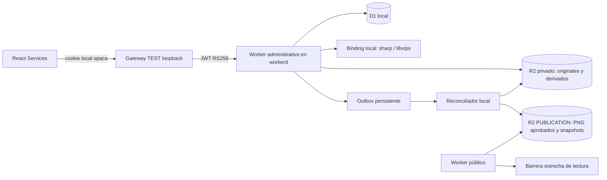

# Fase 2B.6 — Multimedia local

24/10/2026 · America/Costa_Rica. Implementación exclusivamente local.

## Auditoría y decisiones

Se reutilizan MediaAsset, revision_media, sus traducciones, sort_order=0 como
portada, snapshots completos de revisión, If-Match, CAS global, JWT RS256,
RBAC D1, commit transaccional con auditoría y reconciliación 2B.4R.
No se modificaron las migraciones 0001–0005 ni los contratos públicos.
La migración aditiva 0006 agrega versión/resultado del procesamiento y límites
de solicitudes; mantiene registros y referencias anteriores. Los assets legacy
sin procesamiento siguen identificados y no adquieren validación nueva por defecto.

El modelo anterior solo comprobaba metadatos y no transfería bytes públicos.
Ahora se separan original privado, derivado normalizado privado y copia pública
por SHA-256, disponible únicamente mediante el snapshot vigente y su barrera.
Las referencias comerciales reales y la landing/marketplace de Hostinger no cambian.



El Worker público no tiene binding D1 ni PRIVATE_MEDIA. El reconciliador necesita
leer derivados privados para reintentar transferencias: se añadió exclusivamente
ese binding a su configuración LOCAL y se actualizó la comprobación de aislamiento.
No se modificaron las plantillas remotas, cuentas, DNS, Access ni Hostinger.

## Endpoints y permisos

Todas las rutas administrativas pasan por JWT real, administrador activo y grants
D1. No se aceptan claves R2 ni URLs proporcionadas por el cliente.

| Método y ruta bajo /api/v1 | Comportamiento |
|---|---|
| POST /media | Un archivo binario por solicitud; ID UUID y claves generadas por servidor. media:prepare. |
| GET /media?cursor=ID | Biblioteca autorizada paginada a 50; cursor opaco. media:read-private. |
| GET /media/:id | Metadatos sanitizados, estado, versión/ETag; nunca claves privadas. |
| GET /media/:id/preview | PNG normalizado privado, no-store/nosniff/CSP; nunca original en cuarentena. |
| POST /media/:id/validate | Reintento explícito desde cuarentena; If-Match. |
| POST /media/:id/approve | Validada, confirmUsageRights:true, revisor distinto del uploader. |
| POST /media/:id/reject | Cuarentena/validada → rechazada. |
| POST /media/:id/retire | Aprobada → retirada, bloqueada si algún servicio publicado la utiliza. |
| POST /media/:id/cleanup | Retención cumplida, sin referencias de ninguna revisión; tombstone y eliminación reintentable. |
| POST/PATCH /services[/:id] | Contrato existente: asociación, desvinculación, portada, orden y alt ES/EN crean nueva revisión. |

Editor: subir, consultar/previsualizar sus propios archivos, reintentar validación,
asociar archivos propios y preservar asociaciones existentes al revisar un servicio.
Admin/super_admin con grants: acceso global a multimedia y aprobación/rechazo/
retirada/limpieza. Se reutiliza services:publish para estas acciones de revisión,
además de media:prepare. La transacción vuelve a comprobar el permiso D1.
Los recursos ajenos devuelven 404 al editor; los permisos de React no autorizan nada.

POST binario mantiene origen HTTPS canónico, X-Kuwago-Request y Sec-Fetch-Site.
Solo esa ruta omite el requisito JSON; después aplica su lista MIME explícita.
Los otros endpoints conservan JSON y la protección CSRF original.

## Validación y ciclo de vida

- JPEG, PNG y WebP; SVG, formatos activos y multipart rechazados.
- Una imagen por petición, 2 MiB máximo por defecto. MEDIA_MAX_BYTES permite
  reducir el límite; valores inválidos o superiores al límite SQL fallan cerrados.
- Lectura acotada y timeout; firma binaria contrastada con MIME declarado.
- Normalizador LOCAL sharp 0.35.5, failOn:warning, máximo 8 millones de píxeles,
  dimensión máxima 4096, sin animaciones/múltiples páginas.
- Decodificación completa, orientación EXIF aplicada y recodificación a PNG nuevo,
  sin EXIF/ICC/metadatos originales. También se limita el tamaño de salida.
- El Worker comprueba la respuesta del binding, dimensiones, formato y SHA-256.
  Los clientes no pueden proporcionar indicadores de normalización.
- Si falta el binding, permanece **quarantine**. Si el decoder rechaza corrupción,
  queda **rejected**. Si el decoder falla operacionalmente, no se aprueba nada.
- El éxito técnico produce **validated**, nunca approved. La aprobación de uso
  independiente y explícita produce **approved** y provenance=verified.
- Transiciones terminales retired/rejected → deleted; nunca reactivación implícita.
- 30 intentos de subida por principal/hora y 300 lecturas multimedia/minuto.
  Los contadores de lectura antiguos se podan; los de subida se conservan para
  diagnóstico y deben incluirse en la futura política operativa de retención.

sharp se añadió como dependencia **de desarrollo** con versión exacta. Su adaptador
Node se invoca mediante un service binding de Miniflare en el harness; no se importa
en los bundles Worker ni React, ni abre un servidor de normalización público.
Wrangler local sin ese binding sigue siendo seguro: las cargas quedan en cuarentena.
Un decoder nativo de Node no equivale a un decoder desplegable dentro de Workers.

Referencias verificadas: [R2, operaciones condicionales](https://developers.cloudflare.com/r2/api/workers/workers-api-reference/),
[sharp: salida y eliminación de metadatos](https://sharp.pixelplumbing.com/api-output/),
[sharp: orientación](https://sharp.pixelplumbing.com/api-operation/).
Los puts generan claves nuevas y usan etagDoesNotMatch:'*'; no sobrescriben originales.

## React y conservación del diseño

MediaLibrary reutiliza Panel, Button, TextField, ConfirmDialog, preferencias e
identidad de la Fase 1A. Biblioteca y vista privada, carga, portada, movimientos,
alt ES/EN y desvinculación confirmada funcionan dentro del editor existente.
Las asociaciones y textos son cambios sin guardar hasta guardar el borrador.
La carga, validación y aprobación de un asset son operaciones independientes.

El indicador es indeterminado: fetch no ofrece un porcentaje fiable de subida.
No se presenta una carga local como publicación pública. Se mantienen mensajes
distintos para archivos privados y para publicación pendiente/sincronizada.
401/403, 409, validación, cuotas y almacenamiento se muestran sin devolver claves.
Las mutaciones no se reintentan automáticamente. Las solicitudes se cancelan al
desmontar; la previsualización usa la cookie HttpOnly, sin JWT en URLs/localStorage.

## Consistencia, retirada y limpieza

La publicación sigue exigiendo aprobación de cada imagen y aprobación comercial
de la revisión exacta. Las revisiones selladas permanecen inmutables.
Se prohíbe adjuntar archivos rechazados, retirados o eliminados. Un trigger adicional
impide mutar estado, digest o derivado de un asset utilizado por contenido publicado.

Dentro del flujo de outbox, antes de confirmar el snapshot, el reconciliador verifica
y copia solo los derivados aprobados a media/<sha256> en PUBLICATION. Comprueba
el digest de copias existentes; no sobrescribe un objeto distinto.
Si falta el archivo o falla R2, persiste el pendiente y la respuesta sigue siendo 202.
Los leases, backoff, escalamiento y alertas anteriores se reutilizan. También repara
objetos multimedia ausentes al volver a comprobar una generación ya entregada.

GET público /v1/media/:sha256 exige que esa URL esté incluida en el snapshot
validado con la barrera actual, verifica bytes y vuelve a consultar la barrera antes
de responder. Nunca admite una clave arbitraria, original o imagen de un borrador.
La retirada excluye la imagen de ese allowlist; 202 con snapshot antiguo falla cerrado
con 503. No-store evita añadir una caché nueva. No se puede revocar una copia que un
usuario ya descargó; esa limitación no cambia con R2.

Limpieza: 30 días desde retirada/rechazo; todo revision_media, incluso histórico,
bloquea la eliminación física indefinidamente. Primero se confirma tombstone y
auditoría, después se borran los objetos. Si R2 falla, la biblioteca conserva la
tombstone pendiente, puede recargarse y reintentarse con su versión actual.
La clave derivada determinista permite limpiar un put previo cuyo commit falló.
No hay borrado automático por una mera antigüedad ni enumeración destructiva del bucket.
Las copias públicas/snapshots históricos se conservan; no se introduce un GC de
generaciones que pueda romper auditoría o recuperación.

## Restauración coordinada

scripts/media-recovery.mjs complementa el backup lógico original con un archivo
privado de originales/derivados y hashes. Las claves de destino se obtienen de D1,
nunca del JSON del backup. Hay límites de tamaño/cantidad, integridad del archivo,
vínculo al checksum del backup D1 e idempotencia por digest.

El operador recovery:backup guarda ambos en .wrangler/recovery (ignorado por Git).
recovery:restore --confirm-isolated crea otro estado local, aplica las migraciones,
restaura D1 pausada, retira publicaciones y revoca aprobaciones comerciales como antes,
y restaura los bytes. recovery:verify informa archivos ausentes/corruptos.
Un backup antiguo sin archivo multimedia se declara incompleto; nunca se inventan bytes.
Una restauración parcial sigue pausada/sin servicios públicos y requiere revisión.
resume-empty habilita solo catálogo vacío; volver a publicar exige nueva aprobación.
La copia de archivos debe hacerse con las escrituras detenidas: D1 y R2 no tienen
una transacción común. El archivo de backup es privado, no un artefacto distribuible.

## Archivos de esta fase

Nuevos:
```
packages/database/migrations/0006_media_lifecycle.sql
infra/cloudflare/dev/src/multimedia.ts
infra/cloudflare/dev/scripts/image-normalizer.mjs
infra/cloudflare/dev/scripts/media-recovery.mjs
infra/cloudflare/dev/test/multimedia.test.mjs
apps/admin/src/features/services/MediaLibrary.tsx
docs/PHASE-2B6-MULTIMEDIA.md
```
Modificados:
```
packages/database/migrations.sha256.json
infra/cloudflare/dev/package.json
infra/cloudflare/dev/package-lock.json
infra/cloudflare/dev/src/index.ts
infra/cloudflare/dev/src/auth/middleware.ts
infra/cloudflare/dev/src/catalog/types.ts
infra/cloudflare/dev/src/catalog/services.ts
infra/cloudflare/dev/src/catalog/delivery.ts
infra/cloudflare/dev/src/catalog/routes.ts
infra/cloudflare/dev/src/catalog/publication.ts
infra/cloudflare/dev/src/public.ts
infra/cloudflare/dev/src/reconciler.ts
infra/cloudflare/dev/wrangler.reconciler.local.json
infra/cloudflare/dev/scripts/local.mjs
infra/cloudflare/dev/scripts/recovery.mjs
infra/cloudflare/dev/test/admin-harness.mjs
infra/cloudflare/dev/test/authorization.test.mjs
infra/cloudflare/dev/test/config-storage.test.mjs
apps/admin/src/api/admin-client.ts
apps/admin/src/features/services/ApiServiceEditor.tsx
apps/admin/src/features/services/services.css
apps/admin/scripts/e2e-local.mjs
apps/admin/src/test/AdminClient.test.ts
```
Los otros cambios Git de fases anteriores se conservaron.

## Verificación y comandos

```powershell
npm --prefix infra/cloudflare/dev run build
npm --prefix infra/cloudflare/dev run lint
npm --prefix infra/cloudflare/dev test
npm --prefix infra/cloudflare/dev run verify:migrations
npm --prefix infra/cloudflare/dev run validate:config
npm --prefix infra/cloudflare/dev run validate:reconciler
npm --prefix apps/admin run build
npm --prefix apps/admin run lint
npm --prefix apps/admin test
npm --prefix apps/admin run test:e2e:local
npm run check
npm run test:contracts
npm run test:catalog
npm run test:assets
npm run test:loader
npm run test:pwa
```

E2E requiere KUWAGO_PLAYWRIGHT_MODULE apuntando a un Playwright instalado previamente
y Edge/Chromium disponible, como en 2B.5. No instala navegadores/dependencias al correr.
El harness exige los mismos dos flags explícitos para identidades efímeras; mantiene
JWT RS256 real, claves solo de test, HttpOnly/SameSite y verificación RBAC original.
La prueba ya no utiliza attach-synthetic-media: sube dos PNG sintéticos por React,
verifica vista privada y derechos de uso, guarda alt/orden y aprueba comercialmente.

Revisión manual, en dos terminales desde la raíz del repositorio:
```powershell
# Terminal 1: usar únicamente las credenciales efímeras que este proceso imprime.
npm --prefix infra/cloudflare/dev run dev:admin-test -- --provision-test-identities --allow-test-reviewer
# Terminal 2:
npm --prefix apps/admin run dev:local-test
```
Abrir http://127.0.0.1:5175/#services. El reviewer solo se aprovisiona por la
autorización explícita de esos flags; no se crean grants al iniciar sesión.

Resultados: TypeScript estricto, lint y builds aprobados; 115 resultados backend,
31 Admin y 49 contratos/regresiones públicas aprobados; 16 recorridos E2E aprobados.
Los resultados backend incluyen el contenedor de subtests, igual que informes anteriores.
0006 comprobada desde cero y sobre datos legacy, sin alteración ni violaciones FK.
Se verifican corrupción/MIME/SVG/límites, cuarentena, EXIF, identidades, permisos,
objetos ajenos, claves manipuladas, aprobación/rechazo, historial, limpieza,
fallos R2, 202/reconciliación y restauración parcial/bytes íntegros/idempotencia.
El reconciliador se probó también con fallo específico al copiar PNG públicos:
202, barrera cerrada y recuperación mediante la lógica del scheduler existente.
La auditoría npm no reportó vulnerabilidades. El escaneo de fuentes no encontró
claves privadas PEM ni JWT completos. Se compararon 339 fuentes públicas con el
baseline anterior a 2B.5, todas intactas. El build de la landing no incluye Admin,
infra ni dependencias; el bundle Admin no contiene las rutas/identidades del harness
y el Worker público no contiene bindings privados, SQL ni verificador Access.

Capturas y report.json: infra/cloudflare/dev/.wrangler/admin-e2e/:
desktop-light.png, desktop-dark.png, mobile-light.png y mobile-dark.png.
Se revisó que no haya desbordamiento horizontal y que ambos idiomas sigan operativos.
Los PNG son sintéticos; no se subieron imágenes comerciales ni privadas.

## Pendientes y requisitos antes de DEV remoto

1. Elegir/probar un decoder de producción mediante binding privado, con límites de
   CPU, memoria, concurrencia, timeout y garantía de normalización. El adaptador
   sharp Node LOCAL no puede desplegarse sin más como Worker. Sin decoder, cuarentena.
2. Revisar este informe y autorizar separadamente migración 0006, bindings mínimos,
   cuentas/roles, Access y despliegue DEV. Nada de ello se ejecutó aquí.
3. Mantener API pública sin D1/PRIVATE_MEDIA; reconciliador privado con acceso mínimo
   a derivados y PUBLICATION; credenciales/entradas de test ausentes del despliegue.
4. HTTPS, cookie Secure/Access real, MFA, issuer/audience y grants explícitos; BFF same
   origin y CSRF. El gateway de test jamás se reutiliza como login de producción.
5. Aprobar retención/GC, respaldos cifrados, presupuesto de almacenamiento/decodificación,
   alertas y operación de la outbox. Las cuotas locales no sustituyen WAF/abuse controls.
6. Probar restauración y fallos de objetos con el decoder/proveedor real en DEV
   autorizado antes de producción. La prueba local no certifica rendimiento remoto.

Se detiene esta fase para revisión. Sin commit, push, deploy ni operación remota.
